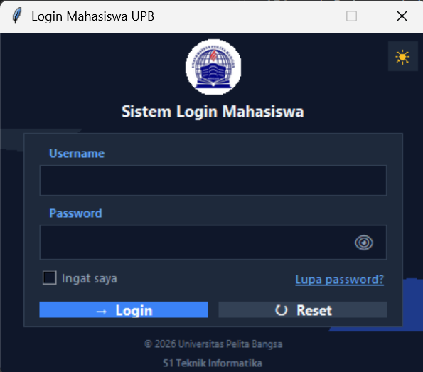

# 🔐 Sistem Login Mahasiswa UPB

Aplikasi login desktop sederhana yang dibuat menggunakan **Python** dan **Tkinter** sebagai tugas mata kuliah **Pemrograman Visual Desktop (PVD)** — Pertemuan 2.

Aplikasi ini mengimplementasikan konsep **IDE, Project, Form, dan GUI** dalam membuat antarmuka login yang fungsional, modern, dan sesuai aturan desain.

---

## 📸 Preview

<p align="center">
  
</p>

> *Screenshot di atas menunjukkan tampilan mode gelap (dark navy). Tersedia juga mode terang yang dapat diaktifkan dengan tombol ☀/🌙 di pojok kanan atas.*

---

## ✨ Fitur Utama

| Fitur | Deskripsi |
|-------|-----------|
| 🔑 **Login dengan Validasi** | Username `admin`, Password `12345` |
| 👁️ **Show / Hide Password** | Ikon mata untuk melihat/menyembunyikan password |
| 🔄 **Reset Form** | Mengosongkan semua input dan checkbox |
| ☑️ **Checkbox "Ingat Saya"** | Menyimpan status login (UI only) |
| 🔗 **Link "Lupa Password?"** | Menampilkan notifikasi bantuan |
| 🌗 **Mode Terang / Gelap** | Toggle tema dark navy ↔ light modern |
| 🎨 **Background Dekoratif** | Blob/lingkaran dekoratif agar tidak monoton |
| 🖼️ **Logo Bulat Otomatis** | Logo PNG di-mask menjadi lingkaran putih penuh |
| 🧾 **Footer Institusi** | Copyright Universitas Pelita Bangsa |
| 💬 **Notifikasi Messagebox** | Success, Warning, dan Error |

---

## 🖥️ Spesifikasi Tampilan

- **Ukuran Window:** `400 x 320` pixel (tidak dapat di-resize)
- **Judul Window:** `Login Mahasiswa UPB`
- **Struktur Layout:**
  - **Frame 1 — Header:** Logo bulat & judul aplikasi
  - **Frame 2 — Card Form:** Input username, password, checkbox, tombol
  - **Footer:** Copyright & program studi
- **Tema Warna:** Dark Navy (default) & Light Mode
- **Font:** Segoe UI (modern & mudah dibaca)

---

## 🚀 Cara Menjalankan

### 1. Prasyarat
- **Python 3.8+** terinstall
- **VS Code** (atau IDE lain)
- Library **Pillow** untuk manipulasi logo:

```bash
pip install Pillow
```

### 2. Struktur Project
```
Tugas Pertemuan 2/
└── src/
    ├── app.py          
    ├── logo.png        
    └── screenshot.png  
```

### 3. Jalankan Aplikasi
Buka terminal pada folder project, lalu:

```bash
python src/app.py
```

---

## 🔑 Akun Demo

| Username | Password |
|----------|----------|
| `admin`  | `12345`  |

> **Catatan:** Jika username/password salah atau kosong, akan muncul notifikasi `error` / `warning`.

---

## 📁 Penjelasan Kode

### Struktur Utama

```python
# 1. Konfigurasi Window
root = tk.Tk()
root.geometry("400x320")
root.resizable(False, False)

# 2. Tema Warna (Dark & Light)
THEMES = { "dark": {...}, "light": {...} }

# 3. Background Canvas + Blob Dekoratif
bg_canvas = tk.Canvas(...)
bg_canvas.create_oval(...)  # 3 blob

# 4. Header (Logo & Judul)
header_frame = tk.Frame(...)

# 5. Card Form Login
card_frame = tk.Frame(...)

# 6. Footer
footer_frame = tk.Frame(...)

# 7. Fungsi Logika
def toggle_password(): ...
def proses_login(): ...
def proses_reset(): ...
def toggle_theme(): ...
```

### Fungsi Utama

| Fungsi | Kegunaan |
|--------|----------|
| `buat_logo_bulat()` | Mengubah PNG menjadi logo bulat dengan background putih |
| `toggle_password()` | Show/hide password dengan ikon 👁 |
| `proses_login()` | Validasi login + notifikasi |
| `proses_reset()` | Reset semua input form |
| `lupa_password()` | Notifikasi bantuan password |
| `toggle_theme()` | Ganti tema dark ↔ light |

---

## 🎨 Palet Warna

### 🌙 Dark Navy (Default)
| Elemen | Warna |
|--------|-------|
| Background | `#0F172A` |
| Card | `#1E293B` |
| Primary (Tombol Login) | `#3B82F6` |
| Reset Button | `#334155` |
| Text Utama | `#F1F5F9` |
| Accent | `#60A5FA` |

### ☀️ Light Mode
| Elemen | Warna |
|--------|-------|
| Background | `#F0F4F8` |
| Card | `#FFFFFF` |
| Primary | `#2563EB` |
| Text Utama | `#0F172A` |
| Accent | `#2563EB` |

---

## ✅ Checklist Aturan Tugas

- [x] Ukuran window `400 x 320` pixel (tidak diubah)
- [x] Judul window `Login Mahasiswa`
- [x] Minimal 2 frame (header & form login)
- [x] Input username & password
- [x] Password disembunyikan (`show="*"`)
- [x] Tombol Login dengan validasi
- [x] Tombol Reset mengosongkan input
- [x] Checkbox "Ingat Saya"
- [x] Link "Lupa Password?"
- [x] Notifikasi messagebox (success/error/warning)
- [x] Warna & font konsisten
- [x] Ikon sederhana (unicode)
- [x] Aplikasi berjalan tanpa error
- [x] Bonus: Dark/Light mode, background blob, logo bulat

---

## 🛠️ Teknologi yang Digunakan

- **Python 3** — Bahasa pemrograman utama
- **Tkinter** — Library GUI standar Python
- **Pillow (PIL)** — Manipulasi gambar (mask logo bulat)
- **VS Code** — Editor kode

---

## 👨‍💻 Author

**Nama:** *(Isi dengan nama kamu)*
**NIM:** *(Isi dengan NIM kamu)*
**Kelas:** S1 Teknik Informatika
**Mata Kuliah:** Pemrograman Visual Desktop (PVD)
**Institusi:** Universitas Pelita Bangsa
**Tahun:** 2026

---

## 📜 Lisensi

Project ini dibuat untuk keperluan **akademik** (Tugas Pertemuan 2 — PVD) yang diajarkan oleh Bapak Anggi Alfin, S.Kom., M.Kom. dan bebas digunakan sebagai referensi.

---

<p align="center">
  <b>© 2026 Universitas Pelita Bangsa — S1 Teknik Informatika</b>
</p>