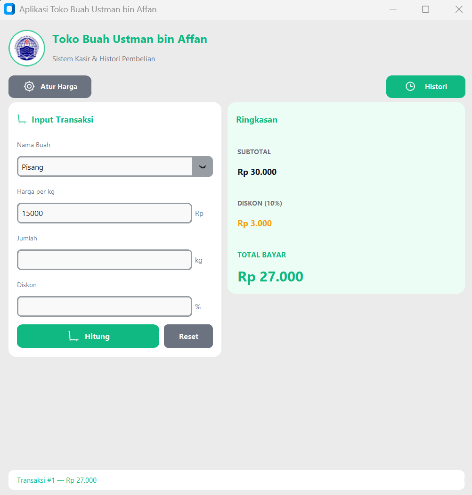
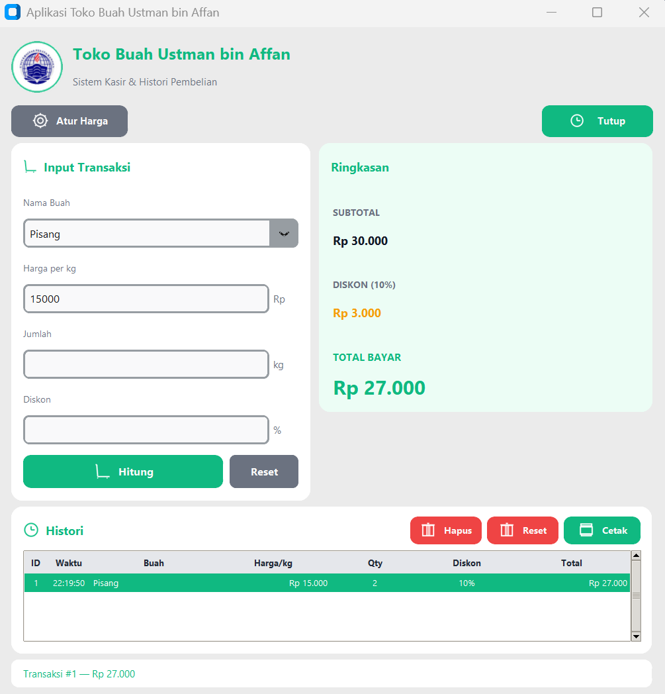
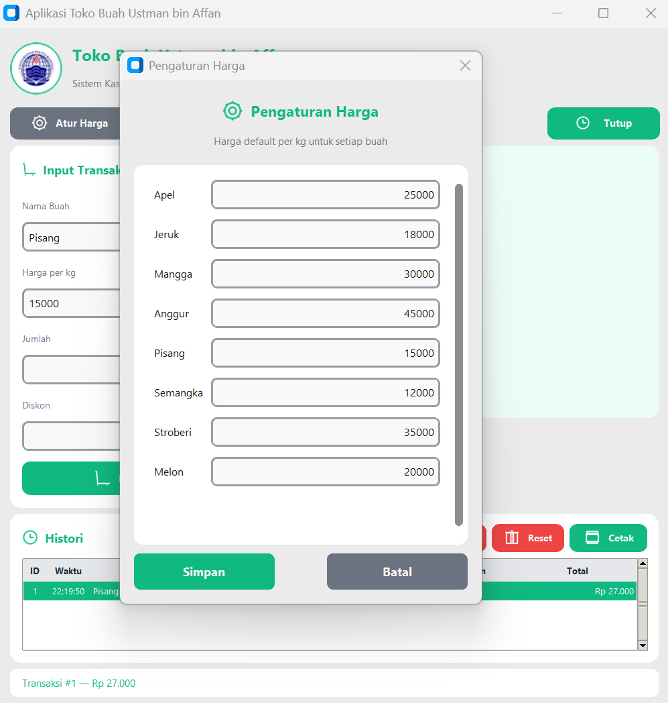

# 🍎 Aplikasi Toko Buah Ustman bin Affan

Aplikasi kasir desktop sederhana yang dibuat menggunakan **Python** dan **CustomTkinter** sebagai tugas mata kuliah **Pemrograman Visual Desktop (PVD)** — Pertemuan 4.

Aplikasi ini mengimplementasikan konsep **IDE, Project, Form, GUI, dan Event Handling** dalam membuat antarmuka kasir toko buah yang fungsional, modern, dan responsif.

---

## 📸 Preview

<p align="center">
  
</p>

> *Screenshot di atas menunjukkan tampilan utama aplikasi: input transaksi di kiri dan ringkasan pembayaran di kanan.*

<p align="center">
  
</p>

> *Screenshot di atas menunjukkan panel histori transaksi yang dapat dibuka/tutup melalui tombol 📜 Histori di toolbar.*

<p align="center">
  
</p>

> *Screenshot di atas menunjukkan dialog pengaturan harga default per kg untuk setiap jenis buah.*

---

## ✨ Fitur Utama

| Fitur | Deskripsi |
|-------|-----------|
| 🛒 **Input Transaksi** | Pilih buah, isi harga, jumlah, dan diskon |
| 💰 **Auto-fill Harga** | Harga terisi otomatis saat buah dipilih (tetap bisa diubah manual) |
| ⚙️ **Pengaturan Harga** | Atur harga default per kg untuk setiap jenis buah |
| 🧮 **Perhitungan Otomatis** | Subtotal, diskon nominal, dan total dihitung real-time |
| 🕒 **ID Transaksi Otomatis** | Setiap transaksi mendapat ID unik (1, 2, 3, dst) |
| 📜 **Histori Transaksi** | Panel histori yang bisa dibuka/tutup sesuai kebutuhan |
| 🗑️ **Hapus Terpilih** | Hapus baris histori tertentu dengan konfirmasi |
| 🔄 **Reset Histori** | Menghapus seluruh histori dan mengulang ID dari 1 |
| 🖨️ **Cetak Struk** | Export struk lengkap ke file `.txt` dengan format rapi |
| 🛡️ **Validasi Input Real-time** | Hanya angka yang bisa diketik, cegah input huruf |
| ⚠️ **Validasi Kosong** | Mencegah submit jika ada kolom yang belum diisi |
| 🎨 **UI Modern dengan Ikon Kustom** | Ikon digambar sendiri via PIL — konsisten & profesional |
| 🖼️ **Logo Bulat Otomatis** | `images/logo.png` dimask jadi lingkaran putih dengan outline hijau |
| 📊 **Status Bar Dinamis** | Feedback visual untuk setiap aksi user |
| 📱 **Responsif & Fleksibel** | Ukuran default 450×450, bisa di-resize bebas tanpa bug |
| 💬 **Notifikasi Messagebox** | Warning, Error, dan Success yang informatif |

---

## 🖥️ Spesifikasi Tampilan

- **Ukuran Window Default:** `450 x 450` pixel
- **Ukuran Minimum:** `400 x 420` pixel
- **Resizable:** ✅ Ya (fleksibel, sesuai keinginan user)
- **Judul Window:** `Aplikasi Toko Buah Ustman bin Affan`
- **Struktur Layout:**
  - **Frame 1 — Header:** Logo bulat & judul aplikasi + subtitle
  - **Frame 2 — Toolbar:** Tombol ⚙️ Atur Harga & 📜 Histori
  - **Frame 3 — Top Section:** Kartu Input (kiri) & Kartu Ringkasan (kanan)
  - **Frame 4 — Bottom Section:** Panel Histori (muncul saat di-toggle)
  - **Frame 5 — Status Bar:** Feedback dinamis di bagian paling bawah
- **Tema Warna:** Fresh Green (default)
- **Font:** Segoe UI (modern & mudah dibaca)

---

## 🚀 Cara Menjalankan

### 1. Prasyarat
- **Python 3.8+** terinstall
- **VS Code** (atau IDE lain)
- Library yang dibutuhkan:

```bash
pip install customtkinter pillow
```

### 2. Struktur Project
```
Tugas Pertemuan 4/
└── src/
    ├── app.py
    └── images/
        ├── logo.png
        ├── preview-home.png
        ├── preview-history.png
        └── preview-price.png
```

> **Catatan:** Letakkan file `logo.png` di dalam folder `src/images/`. Jika file tidak ditemukan, aplikasi tetap berjalan dengan ikon apel default (fallback) — tidak akan error.

### 3. Jalankan Aplikasi
Buka terminal pada folder project, lalu:

```bash
python src/app.py
```

---

## 🔑 Cara Pakai Singkat

| Langkah | Aksi |
|---------|------|
| 1 | Pilih **Nama Buah** dari dropdown → harga terisi otomatis |
| 2 | Ubah **Harga** jika perlu (misal ada harga khusus hari ini) |
| 3 | Isi **Jumlah** (dalam kg) |
| 4 | Isi **Diskon** (opsional, 0-100%) |
| 5 | Klik **Hitung** → transaksi masuk ke histori |
| 6 | Klik **📜 Histori** di toolbar untuk melihat semua transaksi |
| 7 | Klik **🖨️ Cetak** untuk menyimpan struk ke file `.txt` |

### Keyboard Shortcut
| Tombol | Fungsi |
|--------|--------|
| `Enter` | Proses hitung & simpan |
| `Esc` | Reset form input |

---

## 📁 Penjelasan Kode

### Struktur Utama

```python
# 1. Konfigurasi Window
self.geometry("450x450")
self.minsize(400, 420)

# 2. Setup Grid Responsif
self.grid_columnconfigure(0, weight=1)
self.grid_rowconfigure(3, weight=1)  # row filler untuk histori

# 3. Bangun UI dari atas ke bawah
buat_widget()

# 4. Binding Event
self.bind("<Return>", lambda e: self.proses_hitung())
self.bind("<Escape>", lambda e: self.reset_input())
```

### Fungsi Utama

| Fungsi | Kegunaan |
|--------|----------|
| `cari_logo()` | Mencari `logo.png` di folder `images/` relatif ke `app.py` |
| `buat_logo_bulat()` | Mengubah `logo.png` menjadi logo bulat dengan background putih + outline hijau |
| `buat_ikon()` | Menggambar ikon kustom (gear, trash, print, clock, cart, apple) dengan PIL |
| `validate_numeric()` | Validasi real-time: hanya angka & 1 titik desimal yang boleh diketik |
| `attach_validation()` | Pasang validator ke `CTkEntry` (akses internal `_entry`) |
| `center_window_safe()` | Center window dengan clamp agar tidak keluar layar |
| `on_buah_selected()` | Auto-fill harga saat buah dipilih |
| `toggle_histori()` | Show/hide panel histori tanpa memaksa resize |
| `proses_hitung()` | Validasi lengkap + simpan transaksi + update ringkasan |
| `update_tabel()` | Refresh isi Treeview dengan zebra striping |
| `hapus_histori()` | Hapus baris terpilih dari histori |
| `reset_histori()` | Reset seluruh histori transaksi |
| `cetak_histori()` | Export struk ke file `.txt` dengan format rapi |
| `reset_input()` | Kosongkan semua field input |
| `set_status()` | Update pesan status bar |

---

## 🎨 Palet Warna

### 🍃 Fresh Green (Default)
| Elemen | Warna |
|--------|-------|
| Background | `#F3F4F6` |
| Card | `#FFFFFF` |
| Primary (Hijau Daun) | `#10B981` |
| Primary Hover | `#059669` |
| Secondary (Abu) | `#6B7280` |
| Danger (Merah) | `#EF4444` |
| Warning (Oranye) | `#F59E0B` |
| Text Utama | `#111827` |
| Text Muted | `#6B7280` |
| Result Background | `#ECFDF5` |

---

## ✅ Checklist Aturan Tugas

- [x] Ukuran window default `450 x 450` pixel (fleksibel di-resize)
- [x] Judul window `Aplikasi Toko Buah Ustman bin Affan`
- [x] Minimal 2 frame (input & hasil + histori)
- [x] Input nama buah (dropdown combobox)
- [x] Input harga, jumlah, dan diskon dengan validasi angka
- [x] Tombol Hitung dengan validasi lengkap
- [x] Tombol Reset mengosongkan input
- [x] Perhitungan subtotal, diskon, dan total otomatis
- [x] ID transaksi otomatis (1, 2, 3, dst)
- [x] Histori transaksi dengan tabel (Treeview)
- [x] Fitur hapus histori terpilih
- [x] Fitur reset seluruh histori
- [x] Fitur cetak struk ke `.txt`
- [x] Notifikasi messagebox (warning/error/success)
- [x] Warna & font konsisten
- [x] Ikon kustom digambar sendiri (bukan emoji bawaan)
- [x] Logo bulat dari `images/logo.png`
- [x] Aplikasi berjalan tanpa error
- [x] Bonus: Pemisahan logika & UI, validasi real-time, status bar dinamis, responsif & fleksibel

---

## 🛠️ Teknologi yang Digunakan

- **Python 3** — Bahasa pemrograman utama
- **CustomTkinter** — Library GUI modern dengan corner radius & theme support
- **Tkinter (ttk)** — Untuk komponen Treeview dan Scrollbar
- **Pillow (PIL)** — Manipulasi gambar: mask logo bulat, generate ikon kustom
- **VS Code** — Editor kode

---

## 🐛 Known Issues & Solusi

| Masalah | Solusi |
|---------|--------|
| `ModuleNotFoundError: customtkinter` | `pip install customtkinter` |
| `ModuleNotFoundError: PIL` | `pip install pillow` |
| Logo tidak muncul | Pastikan `logo.png` ada di `src/images/logo.png` |
| Font tidak konsisten | Sudah otomatis pakai Segoe UI (bawaan Windows) |
| Aplikasi tidak jalan di macOS/Linux | Ganti font `Segoe UI` ke `Helvetica` atau `Arial` di kode |

---

## 👨‍💻 Author

**Nama:** *Megatama Setiaji*
**NIM:** *312410356*
**Kelas:** S1 Teknik Informatika
**Mata Kuliah:** Pemrograman Visual Desktop (PVD)
**Institusi:** Universitas Pelita Bangsa
**Tahun:** 2026

---

## 📜 Lisensi

Project ini dibuat untuk keperluan **akademik** (Tugas Pertemuan 4 — PVD) yang diajarkan oleh Bapak Anggi Alfin, S.Kom., M.Kom. dan bebas digunakan sebagai referensi.

---

<p align="center">
  <b>© 2026 Universitas Pelita Bangsa — S1 Teknik Informatika</b>
</p>